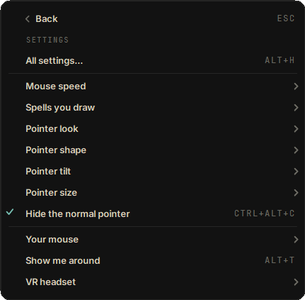
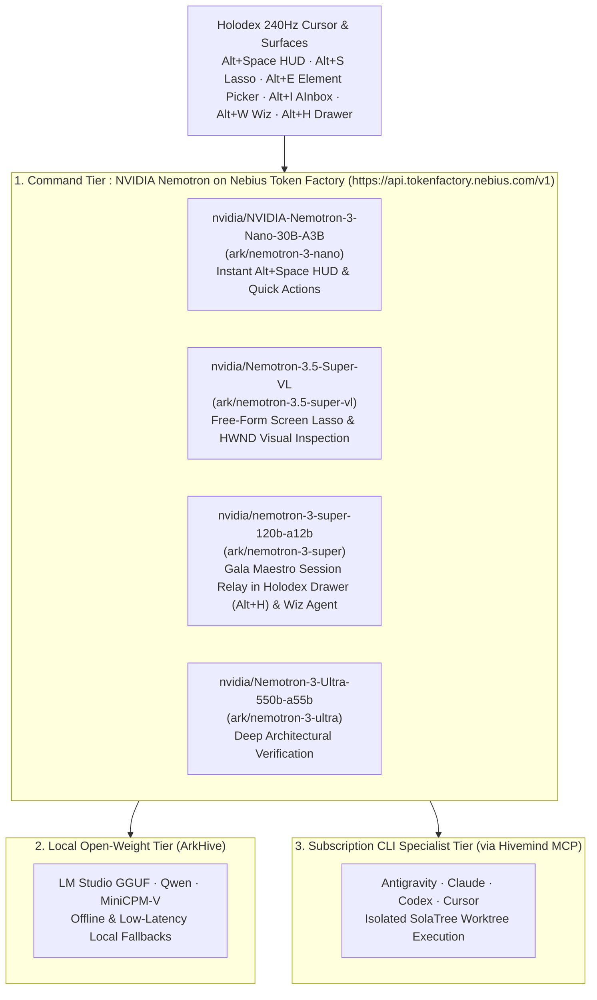

# Holodex

**Holodex** : Native 240Hz Windows AI cursor, radial spell gestures, Free-Form screen lasso (`Nemotron-3.5-Super-VL`), HWND element picker, and `Alt+Space` HUD (`Nemotron-3-Nano-30B-A3B` / `Nemotron-3-Super-120B-A12B`) powered by **NVIDIA Nemotron on Nebius Token Factory** and connected to **Hivemind** ([`GalaAI/hivemind`](https://github.com/GalaAI/hivemind)) and **Ryozan** ([`GalaAI/ryozan`](https://github.com/GalaAI/ryozan)).

> **Nebius x NVIDIA Global AI Hackathon | Track: Personal AI**
> Built on `.NET 10` (`net10.0-windows`), WinForms, and Win32/GDI+ (`UpdateLayeredWindow` + `DwmFlush`), Holodex brings NVIDIA Nemotron models to your Windows cursor in **Standalone Mode** with a `NEBIUS_API_KEY` or in **Hivemind Connected Mode (`Alt+H`)** orchestrated by **Gala**.

**Binary & Vault Compatibility Note:** The product is **Holodex** (`GalaAI/holodex`, renamed from Omniwand on 2026-10-27). To preserve compatibility with existing desktop launchers, the Logitech Actions Ring plugin, and saved user credentials, `Omniwand` remains the internal assembly/executable identifier (`Omniwand.csproj`, `Omniwand.exe`), named control pipe (`ArkStation.Omniwand.Control`), Windows Credential Manager namespace (`wincred://Omniwand:*`), environment variable prefix (`OMNIWAND_*`), and `%LOCALAPPDATA%\Omniwand` profile directory.

More about the Omnitek hardware & software ecosystem: **[arkomnitek.com](https://arkomnitek.com)**

### Why I Built This
> *"I needed help managing my business so I built my shop's app and website from scratch. I taught myself how to develop, build and ship full stack applications using AI. What I didn't expect was to fall in love with the process of architecting orchestrated software and now am founding a tech company called Ark Omnitek made by a tattooer, built for artists and creators. I also wanted to build something that would help other tattooers like my dad. But if it didn't help mine, what good would that do? Once my analytics proved it worked on my shop first, I knew I could confidently give him something that works and put it out there in the world."*  
> **Justin Walker**

---

## How the Trilogy Fits Together (`Holodex` vs. `Hivemind` vs. `Ryozan`)

**Holodex** is one of three standalone, open-source entries in the **ArkOmnitek Trilogy**. All three connect as one end-to-end ecosystem led by **NVIDIA Nemotron on Nebius Token Factory**, while each repository owns a separate layer of the stack:

| Product & Track | What It Is | How It Differs From the Other Two |
| :--- | :--- | :--- |
| **[Holodex](https://github.com/GalaAI/holodex)** *(This Repo)*<br>*Track: Personal AI* | **The Desktop Cursor & Vision Wand.** A native 240Hz Windows AI cursor (`Alt+Space` HUD, `Alt+S` Free-Form screen lasso, `Alt+E` HWND window picker, `Alt+H` drawer) that lets you point at or lasso anything on your screen and act on it immediately. | **OS-level cursor interaction and screen vision (`.NET 10 / C# / Win32`).** Holodex captures live visual context from any desktop window and sends it to **Hivemind** or **Nemotron-3.5-Super-VL**. |
| **[Hivemind](https://github.com/GalaAI/hivemind)**<br>*Track: Coding & Agentic Engineering* | **The Shared Multi-Agent Brain, MCP Broker & OAuth Hub.** The command center where **NVIDIA Nemotron** leads **ArkHive local models** and **subscription CLI agents** (`Antigravity`, `Claude`, `Codex`), paired with clean Google, Pinterest, and TikTok OAuth adapters. | **Orchestration, security, and agentic engineering infrastructure (`TypeScript / Bun / MCP`).** Hivemind routes models, isolates Git worktrees (**SolaTree**), enforces policy (**Aegis**), and syncs credentials (**KeyMaster**). |
| **[Ryozan](https://github.com/GalaAI/ryozan)**<br>*Track: Best Apps & Agents* | **The Brick-and-Mortar Studio & Shop Operating System.** Built on the production system proven at Blind Tiger Tattoo Co. in a **Neo-Ukiyo-e Phosphor** portal where **8 Ryōzanpaku Bandit NPCs** deal **MTG Action Cards** to run bookings, deposits, double-entry bookkeeping (`ryozan-econ`), DMs, and social posts. | **Business and creator operations (`Python FastAPI + React 19`).** Built for working artists and shop owners who talk to their Bandit crew and tap cards to run the shop. |

---

## Screenshots

| Phosphor HUD (`Alt+Space`) | Holodex Drawer (`Alt+H`) | Wiz Crafting (`Alt+W`) |
| --- | --- | --- |
|  |  |  |

| Free-Form Lasso & Element Picker (`Alt+S` / `Alt+E`) | Animated Tooltip Tutorial (`Alt+T`) | AInbox Intake (`Alt+I`) |
| --- | --- | --- |
|  |  |  |

| Tray Menu (`Holodex`) | Settings Page | 240Hz Aperture Morph States |
| --- | --- | --- |
|  |  |  |

---

## 3-Tier Model Orchestration (`Nebius Token Factory` + `ArkHive` + `Subscription CLIs`)

Holodex routes every pointed question, screen capture, AInbox intake stack, and multi-step agent mission across a 3-tier model hierarchy, displaying the model that answered on every UI card:



### Model Orchestration Table

| Tier | Provider / Runtime | Model ID (`Ark Alias`) | Primary Role in Holodex |
| --- | --- | --- | --- |
| **1. Command Tier** | **NVIDIA Nemotron on Nebius Token Factory** (`https://api.tokenfactory.nebius.com/v1`) | `nvidia/NVIDIA-Nemotron-3-Nano-30B-A3B` (`ark/nemotron-3-nano`) | Instant `Alt+Space` HUD text queries, quick actions, and live AInbox stack re-ranking. |
| **1. Command Tier** | **NVIDIA Nemotron on Nebius Token Factory** (`https://api.tokenfactory.nebius.com/v1`) | `nvidia/Nemotron-3.5-Super-VL` (`ark/nemotron-3.5-super-vl`) | Free-Form Screen Lasso (`Alt+S`), HWND Element Picker (`Alt+E`), and screen-attached HUD visual inspection. |
| **1. Command Tier** | **NVIDIA Nemotron on Nebius Token Factory** (`https://api.tokenfactory.nebius.com/v1`) | `nvidia/nemotron-3-super-120b-a12b` (`ark/nemotron-3-super`) | **Gala Maestro** session relay in the docked **Holodex Drawer (`Alt+H`)** and multi-step **Wiz (`Alt+W`)** tool-calling workflows. |
| **1. Command Tier** | **NVIDIA Nemotron on Nebius Token Factory** (`https://api.tokenfactory.nebius.com/v1`) | `nvidia/Nemotron-3-Ultra-550b-a55b` (`ark/nemotron-3-ultra`) | Deep architectural verification and high-complexity synthesis. |
| **2. Local Open-Weight Tier** | **ArkHive Local Runtime** | `LM Studio GGUF`, `Qwen`, `MiniCPM-V` | Local open-weight inference and vision inspection when running offline or paired with local GPU nodes. |
| **3. Subscription CLI Specialist Tier** | **Hivemind Agent Fleet** | `Antigravity`, `Claude`, `Codex`, `Cursor` | Dispatched from the **Holodex Drawer (`Alt+H`)** Work Orders and **AInbox (`Alt+I`)** Handoff Scrolls to execute code and operations in isolated worktrees. |

---

## Plain-English Ark Infrastructure Glossary (4 Core Pillars)

- **SolaTree**: Autonomous Git worktree management infrastructure that isolates every agent task in its own branch and merges verified work.
- **Aegis**: Internal security and policy gate that keeps agents in flow state while protecting credentials and blocking destructive drift.
- **Veritas Deluge**: Global ontology and refactoring engine that updates every file, title, and UI surface when a canonical term changes.
- **KeyMaster**: Dual-vault credential synchronizer that keeps keys synced across local Windows Credential Manager (`DPAPI`) and Google Cloud Secret Manager so you are never locked out.

---

## Quickstart: Standalone Mode (`NEBIUS_API_KEY`) vs. Hivemind Connected Mode (`Alt+H`)

Holodex supports two operating modes out of the box:

| Mode | What You Need | What Works |
| --- | --- | --- |
| **1. Standalone Mode** *(Default for Judges)* | Only a **Nebius Token Factory API Key** (`NEBIUS_API_KEY` or `wincred://Omniwand:NebiusTokenFactory`). Zero local servers required. | Full 240Hz cursor morphs, spell gestures, `Alt+Space` HUD, `Alt+S` Free-Form Lasso (`Nemotron-3.5-Super-VL`), `Alt+E` Element Picker, `Alt+I` AInbox Nemotron re-ranking & Aegis secret redaction, `Alt+W` Wiz agent tool calls (`Nemotron-3-Super-120B-A12B`), and `Alt+H` Holodex Drawer. |
| **2. Hivemind Connected Mode** (`Alt+H`) | Click **Sign in** in the **Holodex Drawer (`Alt+H`)** profile header (OAuth 2.1 + PKCE against `https://hivemind.arkomnitek.com/mcp` or a local `GalaAI/hivemind` server). | Connects your desktop wand to **Hivemind** (`GalaAI/hivemind`) and **Ryozan** (`GalaAI/ryozan`): live 36-agent Syndicate roster, real-time `@Gala` Maestro session relay, asynchronous Work Order mission dispatch & polling, and SHA-256-sealed AInbox Pod Handoffs. |

### Step 1: Download or Build Holodex (Windows 10/11 x64)

#### Option A: Run the Self-Contained Release `.zip` (Recommended)
1. Download **`Holodex-v0.3.0-win-x64.zip`** from the [GitHub Releases](../../releases) page and extract it to any folder.
2. Set your `NEBIUS_API_KEY` (see Step 2 below).
3. Launch **`Omniwand.exe`**. The Phosphor emblem appears in the Windows system tray and the 240Hz wand cursor activates immediately.

#### Option B: Build & Test from Source (`.NET 10 SDK`)
Requires the [.NET 10 SDK](https://dotnet.microsoft.com/download/dotnet/10.0) on Windows 10/11 x64:

```powershell
# Verify Release build & self-test suite
dotnet build Omniwand.csproj -c Release --disable-build-servers -p:UseSharedCompilation=false -nologo

# Publish self-contained win-x64 release bundle
dotnet publish Omniwand.csproj -c Release -r win-x64 --self-contained true -o artifacts/publish-win-x64 --disable-build-servers -p:UseSharedCompilation=false -nologo
```

### Step 2: Configure Standalone Mode (`NEBIUS_API_KEY`)

Holodex never stores API keys in source code, config files, logs, or screenshots. Provide your Nebius Token Factory key via environment variable or Windows Credential Manager (`DPAPI` / `wincred://`):

```powershell
# Option 1: Environment variable (current PowerShell session)
$env:NEBIUS_API_KEY = "your-nebius-token-factory-key"

# Or persist for your Windows user profile
[Environment]::SetEnvironmentVariable("NEBIUS_API_KEY", "your-nebius-token-factory-key", "User")

# Option 2: Store in Windows Credential Manager (KeyMaster DPAPI Vault)
cmdkey /generic:Omniwand:NebiusTokenFactory /user:nebius /pass:your-nebius-token-factory-key
```

You can also paste your Nebius Token Factory key inside the **Holodex Drawer (`Alt+H`)** profile popover (**Replace key**) to seal it in `wincred://Omniwand:NebiusTokenFactory`.

### Step 3: Connect to Hivemind (`Alt+H`) *(Optional Connected Mode)*

1. Press **`Alt+H`** (or hold **`Ctrl` + Sweep Right**) to open the docked **Holodex Drawer**.
2. Click the **Aperture Profile Avatar** at the bottom of the left rail and click **Sign in** under `HIVEMIND`.
3. Holodex runs a native loopback OAuth 2.1 + PKCE flow against Hivemind (`https://hivemind.arkomnitek.com/mcp` or your `OMNIWAND_HIVEMIND_URL`), seals the refresh token in `wincred://Omniwand:HivemindToken`, loads the live agent roster, and streams real-time `@Gala` Maestro sessions and Work Orders.

---

## Key Features (v0.3)

- **240Hz Ark Aperture Morph Engine & 4 On-Brand VSync Cursor Styles (`Alt+C`)**:
  - Default cursor is the **Ark Aperture** (`CursorIconStyle.ArkAperture`) with banking tilt (`RotationMode.SubtleBank`) during operator use and automatic **True Path** rotation + **Coral Globe (`#E08B73`)** when **Wiz** is using the mouse or reasoning.
  - **Contextual State Morphs**:
    - `Arrow`: 3-Wing Cream Aperture + steady Patina Globe (`#69A389`).
    - `Hand` / `AppStarting` (Wiz Active): Aperture opening + steady Coral Globe (`#E08B73`).
    - `IBeam` (Text Cursor): Folds the 3 wings inward into a **solid vertical beam bar glowing Patina (`#69A389`)**.
    - `Crosshair`, `SizeWE/NS/NWSE/NESW`, `SizeAll`, `Wait` (3-Wing Orbital Turbine), `No` (Rust `#D96857` prohibition slash), and `Help` / `UpArrow` (Seal Amber `#D4A359`).
  - Includes 4 morph formations (**Holoscope Iris**, **Syndicate Compass Rose**, **Wiz Wand Star**, **Aegis Shield**) and 3 additional cursor styles (**Relic Wand**, **Phosphor Arrow**, **Viewfinder Reticle**).
- **MagiXLab Video Bench Wand Spell Gesture Engine (`Ctrl` Hold + Gesture)**:
  - Hold `Ctrl` to arm the spell recognizer (right-click arming is opt-in under Settings), rendering a **0.85s tapering Bone/White Ghost Ribbon** + **stochastic 4-point twinkling star dust (`sparks`)** keyed to pointer speed & acceleration + **42-spark omnidirectional starburst** on spell cast:
    1. **Shake Left-Right (`4 swings >= 44px in 900ms`)**: Casts `TIME SPLITTER · WIZ INSPECT` (summons Wiz Crafting).
    2. **Shake Up-Down (`4 swings >= 44px in 900ms`)**: Casts `COPYCAT · LASSO CAPTURE` (arms Free-Form Lasso & Vision Annotator).
    3. **Draw a Circle (`>= 300 deg signed turn + >= 210px travel in 1400ms`)**: Casts `MUTATION · GRIMX SPELL CAST` (casts GrimX Slot 1 Spell).
    4. **Unbroken Sweep Right (`>= 280px`)**: Casts `SYNTHESIZE · HOLODEX BRIDGE` (opens Holodex Syndicate Session).
- **Tray Menu That Turns Pages**:
  - Clicking the tray icon opens one panel centered above the icon. The home page holds the primary surfaces (`Ask a question`, `Open Holodex`, `Make a spell with Wiz`, `Grab from the screen >`, `Spell Orb >`, `Settings >`); a `>` row turns the same panel to its page, and `Back` (or `Esc`, `Backspace`, `Left`) returns.
- **Zero-Manual Wiz Environment Onboarding & Animated Phosphor Tooltips (`Alt+T`)**:
  - On first launch, **Wiz** scans your hardware (connected mouse brand & model via VID/PID, Windows pointer speed, display DPI, installed CLIs, and Windows Credential Manager `wincred://` vault), provisions `~/.ark/agents/omniwand` (`omniwand.agent.bamf.json` + `SKILL.md` + `mouse-macros.json`), and launches a 7-step **guided tour** with eased Phosphor motion and keycap shortcuts.
- **Intelligent Mouse Brand Detection, Live Pointer Speed Slider & Adaptive Profiles**:
  - Detects connected mice across **Logitech** (MX Master 4 / 3S, G PRO X Superlight 2, G502), **Razer**, **Corsair**, **SteelSeries**, **Glorious**, **Finalmouse**, **Pulsar**, **ASUS ROG**, and **Microsoft** via Windows Raw Input (`RIDEV_INPUTSINK`) and persists per-device profiles in `%LOCALAPPDATA%\Omniwand\mouse-profiles.json`.
- **Free-Form Lasso, Phosphor Annotation Studio & Desktop Element Picker (`Alt+S` / `Alt+E`)**:
  - Draw a **Free-Form Lasso** or **Rectangle Snip**, annotate with Coral/Patina/Amber pens, arrows, or boxes, or inspect any desktop window (`WindowFromPoint` HWND class, title, bounding rect, and live 6x pixel magnifier with click-to-copy HEX).
  - Route any capture to **NVIDIA Nemotron Vision** (`nvidia/Nemotron-3.5-Super-VL`) on Nebius Token Factory or save into the **Holodex Codex**.
- **AInbox Multi-Capture Stack, Aegis Secret Redaction & Sealed Handoff Scrolls (`Alt+I`)**:
  - Drop, paste, or pick any number of captures. Captures stack by window/repo context, Omnitek heuristics provide an initial pass, and **`nvidia/NVIDIA-Nemotron-3-Nano-30B-A3B`** re-ranks intents and synthesizes a structured **Handoff Scroll** after **Aegis** redacts credentials and seals the payload with SHA-256.
- **Holodex Drawer (`Alt+H`) & Hivemind MCP Session Relay**:
  - Docked right-edge Relic Phosphor drawer with 5 operational tabs (`Session`, `AInbox`, `Codex`, `GrimX`, `Mods`), connecting `wincred://Omniwand:NebiusTokenFactory` and `wincred://Omniwand:HivemindToken`.

---

## Keyboard & Mouse Shortcuts

| Action | Shortcut |
| --- | --- |
| Summon **Phosphor HUD** (`Nemotron-3-Nano-30B-A3B` / `Nemotron-3.5-Super-VL`) | `Alt+Space` (or double-click tray icon) |
| Toggle **Holodex Drawer** (`Session`, `AInbox`, `Codex`, `GrimX`, `Mods`) | `Alt+H` or **Ctrl + Sweep Right** |
| **Free-Form Lasso & Phosphor Annotator** (`Nemotron-3.5-Super-VL`) | `Alt+S` or **Ctrl + Shake Up and Down** |
| **Desktop Element & Pixel Palette Picker** (`HWND` + `Nemotron-3.5-Super-VL`) | `Alt+E` or **Right-Hold + Flick West** |
| Summon **Wiz Agent & Spell Crafting** (`Nemotron-3-Super-120B-A12B`) | `Alt+W` or **Right-Hold + Flick East** |
| Summon **AInbox Multi-Capture Intake** (`Nemotron-3-Nano-30B-A3B` + `Aegis`) | `Alt+I` |
| Launch **Animated Phosphor Tooltip Tutorials** | `Alt+T` (auto-runs on first onboarding) |
| Summon the **Spell Orb** | `F15` or hold **Middle Mouse Button** (`>180ms`) |
| Cycle On-Brand Cursor Style (`Relic Wand`, `Ark Aperture`, `Phosphor Arrow`, `Viewfinder`) | `Alt+C` |
| Toggle Native Windows Cursor Visibility | `Ctrl+Alt+C` |
| Exit & Restore Default Windows Cursor | `Ctrl+Alt+Q` (or via Tray Menu) |

---

## License

Licensed under the **Apache License, Version 2.0** (see [`LICENSE`](LICENSE)).
Bundled fonts (`Inter`, `Space Grotesk`, `JetBrains Mono`, `Archivo Black`) are licensed under the **SIL Open Font License 1.1** (see [`NOTICE`](NOTICE) and `assets/fonts/`).
