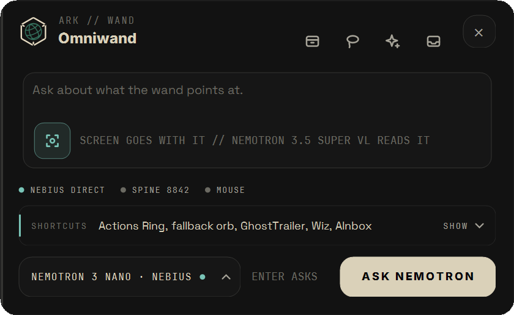
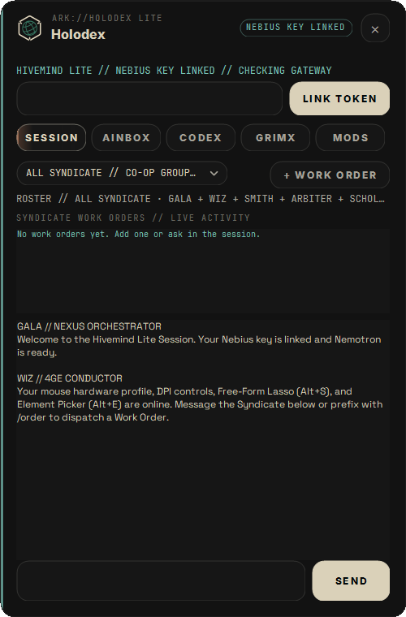
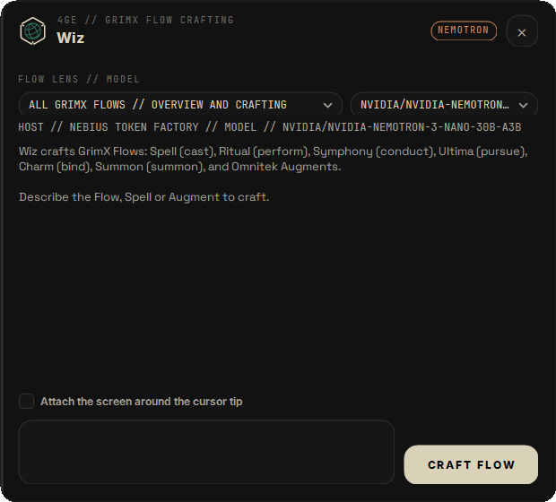
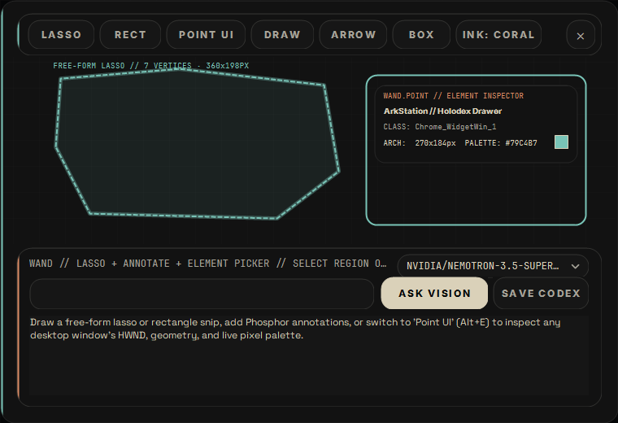
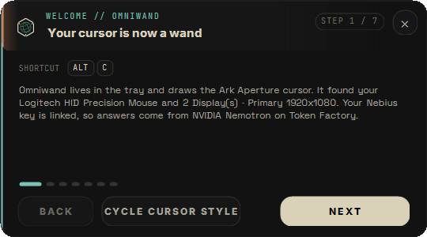
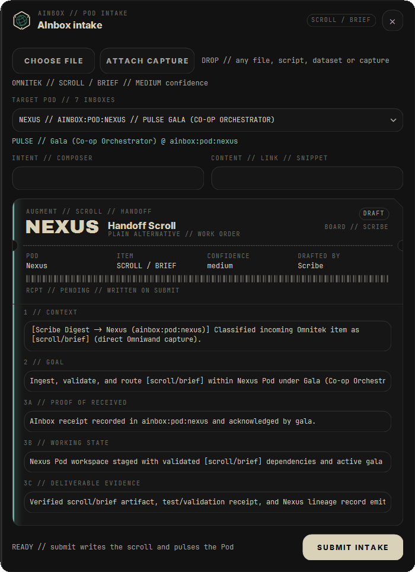
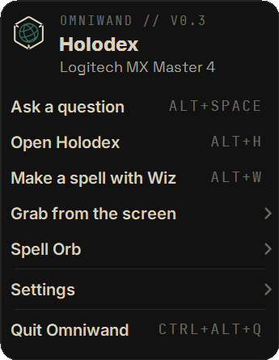
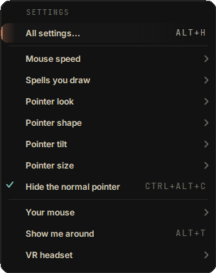
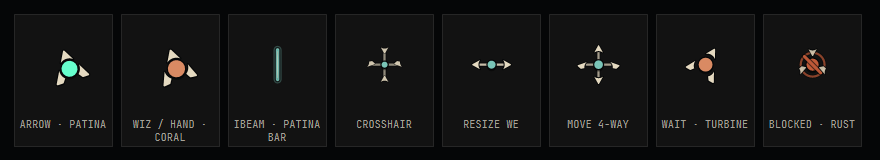

# Omniwand v0.3: Phosphor Shell, Holodex Lite & GrimX Flow Desktop AI Wand

**Omniwand** is a native Windows desktop AI cursor, radial workflow wand, screen lasso & element inspector, and **Holodex Lite** control deck built on .NET 10 (`net10.0-windows`), WinForms, and Win32/GDI+ (`UpdateLayeredWindow` + `DwmFlush`).

It replaces or overlays the system cursor with a critically-damped Phosphor wand supporting 4 on-brand cursor styles (**Relic Wand**, **Ark Aperture**, **Phosphor Arrow**, and **Viewfinder Reticle**), directional **Right-Hold Gesture Flicks**, intelligent mouse hardware & live DPI speed control, **Zero-Manual Wiz Onboarding** with animated Phosphor tooltip tutorials, **Free-Form Lasso / Phosphor Annotator / Desktop Element Picker**, and a docked **Holodex Lite Drawer** with **Hivemind Lite Token Login** (`wincred://` Windows Credential Manager vault) and 5 operational tabs (`Session`, `AInbox`, `Codex`, `GrimX`, `Mods`).

More about the Omnitek hardware & software ecosystem: **[arkomnitek.com](https://arkomnitek.com)**

---

## Screenshots

| Phosphor HUD (`Alt+Space`) | Holodex Lite Drawer (`Alt+H`) | Wiz Crafting (`Alt+W`) |
| --- | --- | --- |
|  |  |  |

| Free-Form Lasso & Element Picker (`Alt+S` / `Alt+E`) | Animated Tooltip Tutorial (`Alt+T`) | AInbox Intake (`Alt+I`) |
| --- | --- | --- |
|  |  |  |

| Tray Menu (`Omniwand // v0.3`) | Settings & Spellbook Submenus | 240Hz Aperture Morph States |
| --- | --- | --- |
|  |  |  |

---

## Key Features (v0.3)

- **240Hz Ark Aperture Morph Engine & 4 On-Brand VSync Cursor Styles (`Alt+C`)**:
  - Default cursor is the **Ark Aperture** (`CursorIconStyle.ArkAperture`) with subtle banking tilt (`RotationMode.SubtleBank`) during normal operator use and automatic **True Path** rotation + **Coral Globe (`#E08B73`)** when **Wiz** is actively using the mouse or reasoning.
  - **Subtle, Non-Pulsing Contextual State Morphs**:
    - `Arrow`: Pure 3-Wing Cream Aperture + steady Patina Globe (`#69A389`).
    - `Hand` / `AppStarting` (Wiz Active): Subtle Aperture opening + steady Coral Globe (`#E08B73`).
    - `IBeam` (Text Cursor): Smoothly folds the 3 wings inward into a **solid, basic vertical beam bar glowing Patina (`#69A389`)** (steady, non-pulsing).
    - `Crosshair`, `SizeWE/NS/NWSE/NESW`, `SizeAll`, `Wait` (3-Wing Orbital Turbine), `No` (Rust `#D96857` prohibition slash), and `Help` / `UpArrow` (Seal Amber `#D4A359`).
  - Also includes 4 creative morph formations (**Holoscope Iris**, **Syndicate Compass Rose**, **Wiz Wand Star**, **Aegis Shield**) and 3 additional cursor styles (**Relic Wand**, **Phosphor Arrow**, **Viewfinder Reticle**).
- **MagiXLab Video Bench `Omniwand` Spell Gesture Engine (`Ctrl` Hold + Gesture)**:
  - Ported from the original `Ark Shell S4` MagiXLab Video Bench concept (`ad2b6a14-756e-440d-b3fa-65db8e365c20`): hold `Ctrl` to arm the spell recognizer (right-click arming is opt-in under Settings), rendering a **0.85s tapering Bone/White Ghost Ribbon** + **stochastic 4-point twinkling star dust (`sparks`)** keyed to pointer speed & acceleration + **42-spark omnidirectional starburst** on spell cast:
    1. **Shake Left-Right (`4 swings ≥ 44px in 900ms`)**: Casts `TIME SPLITTER · WIZ INSPECT` (summons Wiz Crafting).
    2. **Shake Up-Down (`4 swings ≥ 44px in 900ms`)**: Casts `COPYCAT · LASSO CAPTURE` (arms Free-Form Lasso & Vision Annotator).
    3. **Draw a Circle (`≥ 300° signed turn + ≥ 210px travel in 1400ms`)**: Casts `MUTATION · GRIMX SPELL CAST` (casts GrimX Slot 1 Spell).
    4. **Unbroken Sweep Right (`≥ 280px`)**: Casts `SYNTHESIZE · HOLODEX BRIDGE` (opens Holodex Lite Syndicate Session).
- **Streamlined Root Tray Menu & Consolidated `Settings` Menu**:
  - Top-level tray menu keeps the 6 primary workflow surfaces (`Phosphor HUD`, `Holodex Lite drawer`, `Wiz crafting`, `Capture & intake >`, `GrimX Flow orb >`, `Settings >`) while housing all hardware, cursor, morph, DPI slider (`100 to 4000 DPI`), spellbook, onboarding, and VR controls cleanly inside **`Settings`**.
- **Zero-Manual Wiz Environment Onboarding & Animated Phosphor Tooltips (`Alt+T`)**:
  - On first launch, **Wiz** automatically scans your hardware (connected mouse brand & model via VID/PID, Windows pointer speed, display DPI, installed CLIs, and Windows Credential Manager `wincred://` vault), auto-provisions `~/.ark/agents/omniwand` (`omniwand.agent.bamf.json` + `SKILL.md` + `mouse-macros.json`), and launches a 7-step **guided tour** with eased Phosphor motion, keycap shortcuts and keyboard navigation (Left, Right, Esc) with zero manual configuration.
- **Intelligent Mouse Brand Detection, Live 100 to 4000 DPI Slider & Macro Binder**:
  - Detects connected mice across **Logitech** (MX Master 4 / 3S, G Pro X Superlight, G502), **Razer**, **Corsair**, **SteelSeries**, **Glorious**, **Finalmouse**, **Pulsar**, **ASUS ROG**, and **Microsoft**.
  - Custom-drawn **Relic Phosphor DPI Slider (`100 DPI` sniper precision up to `4000 DPI`)** embedded directly in both `Settings -> Mouse DPI` and the `Holodex -> Mods` tab, synchronized in real time with `SystemParametersInfo` (`SPI_GETMOUSESPEED` / `SPI_SETMOUSESPEED` 1 to 20).
- **Free-Form Lasso, Phosphor Annotation Studio & Desktop Element Picker (`Alt+S` / `Alt+E`)**:
  - Full-desktop capture overlay implementing the original Ark Wand toolset (`wand.point`, `wand.annotate`, `wand.capture`, `wand.palette`, `wand.architect`).
  - Draw a **Free-Form Lasso** or **Rectangle Snip**, annotate with Coral/Patina/Amber pens, arrows, or boxes, or inspect any desktop window (`WindowFromPoint` HWND class, title, bounding rect, and live 6x pixel magnifier with click-to-copy HEX).
  - Route any capture to **Multi-Model Vision** (`nvidia/Nemotron-3.5-Super-VL`, `openbmb/MiniCPM-V-4_5`, `Qwen/Qwen2.5-VL-72B-Instruct`, `google/gemma-3-27b-it`, or `ark/kimi`) or save directly into the **Holodex Codex**.
- **Holodex Lite Drawer (`Alt+H`) & Token Vault Login**:
  - Right-edge Relic Phosphor dashboard drawer with one-click **Token Login** (stores your Nebius Token Factory API key directly in Windows Credential Manager `wincred://` under `Omniwand:NebiusTokenFactory`).
  - Includes 5 lite tabs:
    1. **Session**: Syndicate Group Chat (`@Gala`, `@Wiz`, `@Smith`, `@Arbiter`, `@Scholar`, `@Muse`, `@Fabrix`, `@Herald`) with live **Work Orders** and **Activity Feed**.
    2. **AInbox**: Drag-and-drop Pod Intake classifier and Handoff Scroll generator.
    3. **Codex**: Persistent visual knowledge base of Lasso captures, UI inspections, and vision analyses.
    4. **GrimX**: Capability catalog (`Spell`, `Ritual`, `Symphony`, `Ultima`, `Charm`, `Summon`) with one-click execution and Wiz Flow crafting.
    5. **Mods**: Hardware & augment deck showing live mouse VID/PID telemetry, DPI speed presets, cursor icon switcher, and `wincred://` Vault status.

---

## How NVIDIA Nemotron & Nebius Token Factory Are Used

In **Standalone Mode** (default when running standalone or when `OMNIWAND_STANDALONE=1` is set), Omniwand routes all AI completions directly to **Nebius Token Factory** (`https://api.tokenfactory.nebius.com/v1/chat/completions` and `/v1/models`) using **NVIDIA Nemotron** open models:

1. **Fast Tier Cursor Calls (`nvidia/NVIDIA-Nemotron-3-Nano-30B-A3B` / `nvidia/Nemotron-3_5-Lightning`)**:
   - Used as the default model in `ModelPicker` for low-latency pointed HUD queries (`Alt+Space`).
2. **Reasoning, Vision & Workflow Crafting (`nvidia/nemotron-3-super-120b-a12b`, `nvidia/Nemotron-3.5-Super-VL`, `nvidia/Nemotron-3-Ultra-550b-a55b`)**:
   - Selectable in the shared `ModelPicker` dropdown inside both the **Phosphor HUD** and **Wiz Crafting (`Alt+W`)** to draft structured GrimX Flows (`Spell`, `Ritual`, `Symphony`, `Ultima`, `Charm`, `Summon`).
3. **Dynamic Model Discovery**:
   - When a Token Factory key is present, `ArkStationClient.GetAvailableModelsAsync()` queries `GET https://api.tokenfactory.nebius.com/v1/models` and merges any live Nemotron model IDs into the `ModelPicker` dropdown.

---

## Installation & Setup

### Option A: Run the Self-Contained Release Build (Windows x64)

1. Download `Omniwand-win-x64.zip` from the [GitHub Releases](../../releases) page and extract it to any folder.
2. Configure your **Nebius Token Factory API Key** (see below).
3. Launch `Omniwand.exe`. A Phosphor tray icon appears in the Windows system tray and the wand cursor activates immediately.

### Option B: Build from Source

Requires the [.NET 10 SDK](https://dotnet.microsoft.com/download/dotnet/10.0) on Windows 10/11 x64.

```powershell
# Build Debug
dotnet build Omniwand.csproj -c Debug --disable-build-servers -p:UseSharedCompilation=false -nologo

# Publish self-contained win-x64 release
dotnet publish Omniwand.csproj -c Release -r win-x64 --self-contained true -o publish/win-x64 --disable-build-servers -p:UseSharedCompilation=false -nologo
```

---

## Setting Your Nebius Token Factory Key

Omniwand never stores API keys in source code, config files, logs, or screenshots. Provide your Nebius Token Factory API key using either an environment variable or **Windows Credential Manager**:

### 1. Environment Variable (PowerShell)

```powershell
# Current session
$env:NEBIUS_API_KEY = "your-nebius-token-factory-key"

# Or persist for your Windows user profile
[Environment]::SetEnvironmentVariable("NEBIUS_API_KEY", "your-nebius-token-factory-key", "User")
```

*(Optional)* Override the base URL if using a custom endpoint:
```powershell
$env:NEBIUS_BASE_URL = "https://api.tokenfactory.nebius.com/v1"
```

### 2. Holodex Lite Token Login (`Alt+H`) or Windows Credential Manager (`wincred://`)

Paste your Nebius Token Factory API key directly into the **Holodex Lite Drawer (`Alt+H`)** header and click **Connect Vault**, Omniwand stores it securely in Windows Credential Manager (`wincred://` target `Omniwand:NebiusTokenFactory`). Or set it from PowerShell:

```powershell
cmdkey /generic:Omniwand:NebiusTokenFactory /user:nebius /pass:your-nebius-token-factory-key
```

If no key is configured, Omniwand still launches normally, runs all cursor physics and overlays without hanging, and displays a Phosphor toast explaining how to set `NEBIUS_API_KEY` when you send a prompt.

---

## Keyboard & Mouse Shortcuts

| Action | Shortcut |
| --- | --- |
| Summon **Phosphor HUD** | `Alt+Space` (or double-click tray icon) |
| Toggle **Holodex Lite Drawer** (`Session`, `AInbox`, `Codex`, `GrimX`, `Mods`) | `Alt+H` or **Ctrl + Sweep Right** |
| **Free-Form Lasso & Phosphor Annotator** (`wand.capture` / `wand.annotate`) | `Alt+S` or **Ctrl + Shake Up and Down** |
| **Desktop Element & Pixel Palette Picker** (`wand.point` / `wand.palette`) | `Alt+E` or **Right-Hold + Flick West** |
| Summon **Wiz Crafting** | `Alt+W` or **Right-Hold + Flick East** |
| Summon **AInbox Intake** | `Alt+I` |
| Launch **Animated Phosphor Tooltip Tutorials** | `Alt+T` (auto-runs on first onboarding) |
| Summon **GrimX Flow Radial Orb** | `F15` or hold **Middle Mouse Button** (`>180ms`) |
| Cycle On-Brand Cursor Style (`Relic Wand`, `Ark Aperture`, `Phosphor Arrow`, `Viewfinder`) | `Alt+C` |
| Toggle Native Windows Cursor Visibility | `Ctrl+Alt+C` |
| Exit & Restore Default Windows Cursor | `Ctrl+Alt+Q` (or via Tray Menu) |

---


### Optional mouse side-button macros

Mouse4 and Mouse5 are browser Back and Forward, so Omniwand leaves them alone by default. To bind them (and right-drag flicks) to Lasso and Holodex, set `OMNIWAND_MOUSE_MACROS=1` before launching.

### Hover tooltips

Every Omniwand control explains itself on hover: a short dwell, then a tip that rises and fades in on the Ark disclosure timing (180ms, ease-analog), with the keyboard shortcut drawn as keycaps. Windows "Show animations" off turns the motion off.

## Tips

- **Optional ArkStation Integration**: When running on a host with an active ArkStation instance, Omniwand automatically detects the local integration and enables live gesture bindings alongside Nebius Token Factory.
- **Optional Logitech MX Master 4 Support**: Omniwand automatically detects a connected Logitech MX Master 4 (`VID_046D&PID_B042`) for Actions Ring bindings (`F15` / `F16` / named pipe `ArkStation.Omniwand.Control`), and falls back cleanly to Universal Mouse mode on any standard mouse.

---

## What Was Significantly Updated After August 26, 2026

- **Relic Phosphor Shell UI & Custom Controls (`PhosphorKit.cs`, `PhosphorTheme.cs`, `PhosphorMenuRenderer.cs`, `PhosphorToast.cs`)**: Complete custom-drawn WinForms component kit (`PhosphorBadge`, `PhosphorButton`, `PhosphorField`, `PhosphorComboBox`, `SpecCardPanel`, `HighlightAura`, `PhosphorToast`) built from the ratified Relic Phosphor token system.
- **On-Brand Cursor Styles, Hardware Detection, Live DPI & Gesture Engine (`MouseHardwareAndWandEngine.cs`)**: Added 4 custom GDI+ cursor geometries (`RelicWand`, `ArkAperture`, `PhosphorArrow`, `ViewfinderReticle`), USB VID/PID mouse brand & model recognition, live `SystemParametersInfo` pointer speed/DPI control (`1-20`), `Mouse4`/`Mouse5` macro binder, and `Right-Hold` directional gesture flicks.
- **Zero-Manual Wiz Onboarding & Animated Phosphor Tooltips (`WizOnboardingAndTooltips.cs`)**: Automatic environment scanner and `~/.ark/agents/omniwand` `.bamf` agent provisioner paired with a 60fps floating Phosphor tooltip tutorial walkthrough.
- **Free-Form Lasso, Phosphor Annotator & Desktop Element Picker (`ScreenSnipAndElementPickerForm.cs`)**: Full-screen interactive capture and HWND element/pixel inspector with multi-model vision routing (`nvidia/Nemotron-3.5-Super-VL`, `openbmb/MiniCPM-V-4_5`, `Qwen/Qwen2.5-VL-72B-Instruct`, `google/gemma-3-27b-it`) and Codex persistence.
- **Holodex Lite Drawer & Hivemind Lite Token Login (`HolodexLiteDrawerForm.cs`, `ArkStationClient.cs`)**: Docked right-edge dashboard drawer with `wincred://` Token Login and 5 tabs (`Session` Syndicate group chat & work orders, `AInbox`, `Codex`, `GrimX`, `Mods`).
- **Standalone Nebius Token Factory & NVIDIA Nemotron Provider (`ArkStationClient.cs`, `ModelPicker.cs`, `OmniwandHudForm.cs`, `WizCraftingWidgetForm.cs`)**: Direct OpenAI-compatible runtime integration with Nebius Token Factory (`https://api.tokenfactory.nebius.com/v1/chat/completions` & `/v1/models`) defaulting to NVIDIA Nemotron models (`nvidia/NVIDIA-Nemotron-3-Nano-30B-A3B`, `nvidia/Nemotron-3_5-Lightning`, `nvidia/nemotron-3-super-120b-a12b`, `nvidia/Nemotron-3.5-Super-VL`, `nvidia/Nemotron-3-Ultra-550b-a55b`), with Windows Credential Manager (`CredReadW`/`CredWriteW`) and environment variable key resolution plus graceful standalone degradation.
- **Kinematics, VR Cursor Cache Guard & As-Built Surface Capture (`Program.cs`, `RotationPreview.cs`, `VrStreamDetector.cs`, `SurfaceCapture.cs`)**: Animated tray rotation previews, headset stream auto-detection, and offscreen `render:<folder>` PNG capture pipeline.

---

## License

Licensed under the **Apache License, Version 2.0** (see [`LICENSE`](LICENSE)).
Bundled fonts (`Inter`, `Space Grotesk`, `JetBrains Mono`, `Archivo Black`) are licensed under the **SIL Open Font License 1.1** (see [`NOTICE`](NOTICE) and `assets/fonts/`).
